<div align="center">

# 🔥 DoyinSpark · 抖音火花守护系统

**会员制 SaaS · 卡密开通 · 多租户隔离 · 真实通道发送**

`Go + Gin + GORM + MySQL + Redis` · `Vue 3 + TypeScript + Vite` · 手写暗色余烬设计系统

</div>

## 🌐 线上地址

| 入口 | 地址 |
| --- | --- |
| 内网（Tailscale） | https://mac.tail17f525.ts.net:9443 |
| 公网（Cloudflare） | https://spark.lkke.me · https://douyinspark.lkke.me |

部署细节见 [docs/DEPLOY.md](docs/DEPLOY.md)（OrbStack + Tailscale Serve + Cloudflare Tunnel + launchd）。

---

## 📸 界面预览

| 登录 | 注册开通（必须卡密） |
| --- | --- |
| 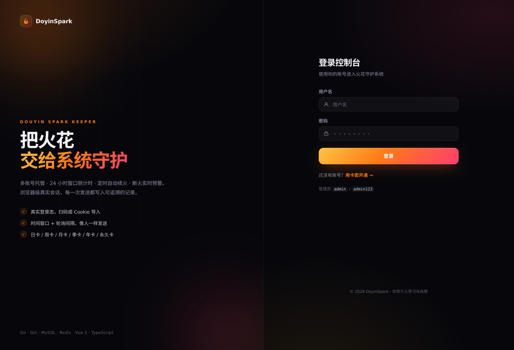 | 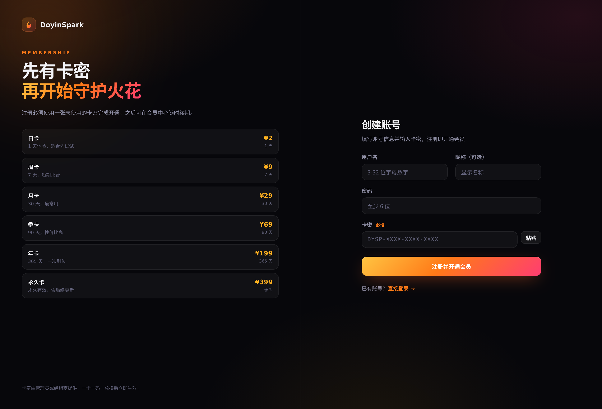 |

| 会员中心 | 卡密管理（管理员） |
| --- | --- |
| 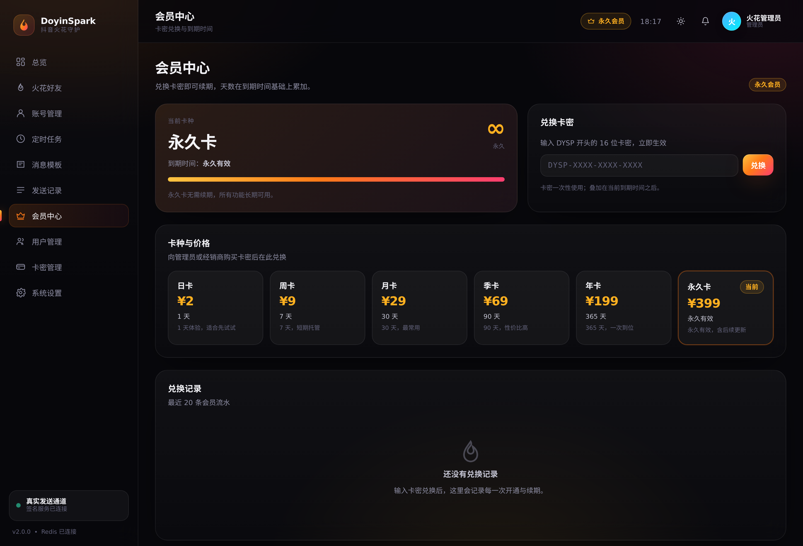 | 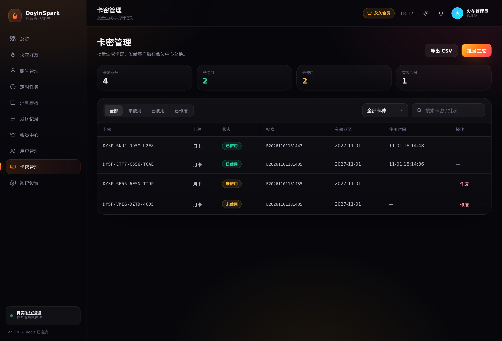 |

<details>
<summary>更多页面</summary>

| 总览看板 | 火花好友 |
| --- | --- |
| 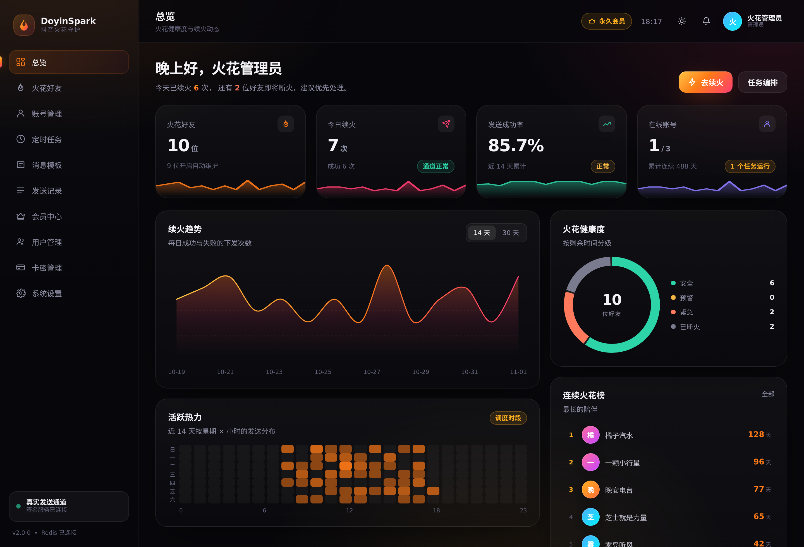 | 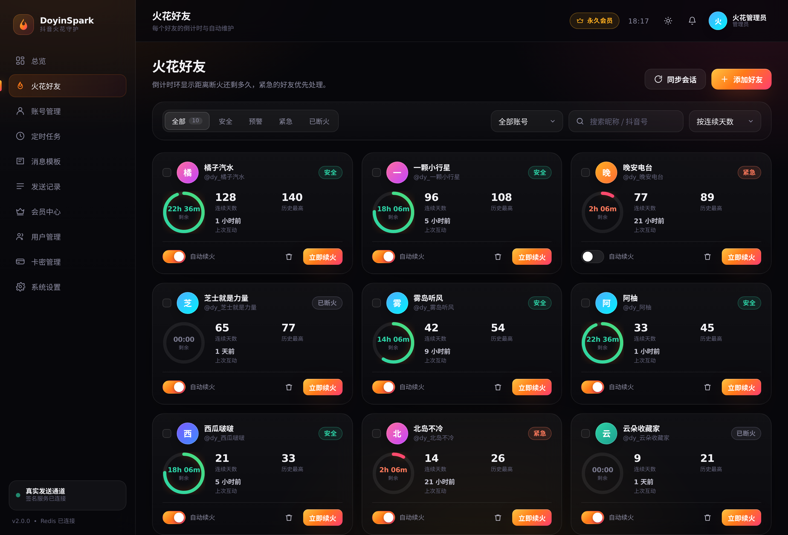 |

| 账号管理 | 定时任务 |
| --- | --- |
| 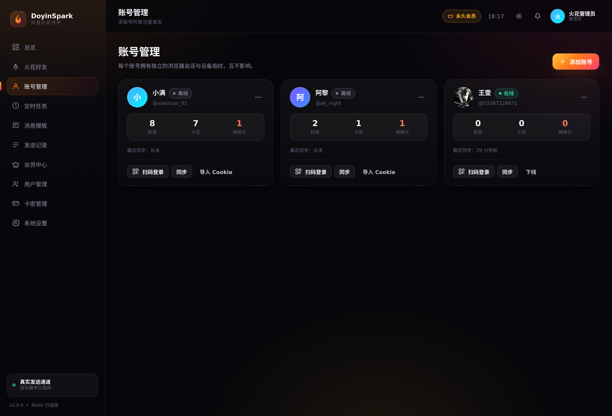 | 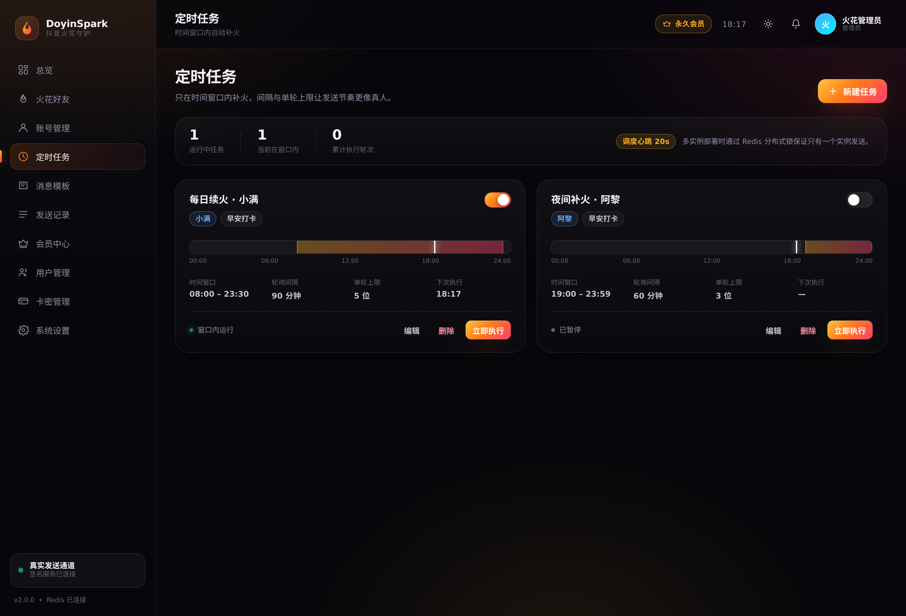 |

| 消息模板 | 发送记录 |
| --- | --- |
| 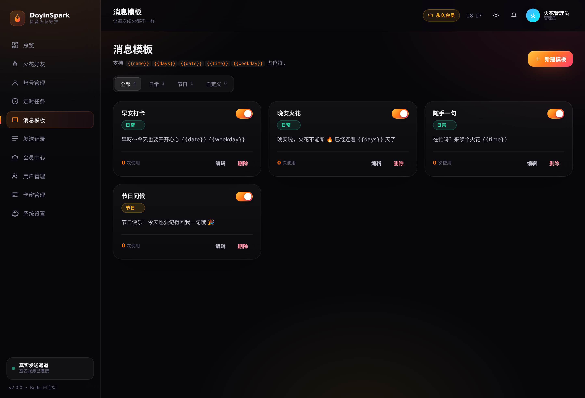 | 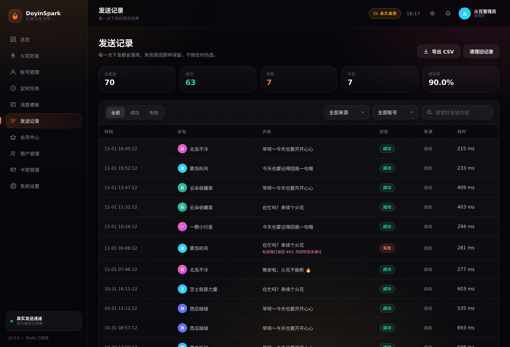 |

| 系统设置 | 用户管理（管理员） |
| --- | --- |
| 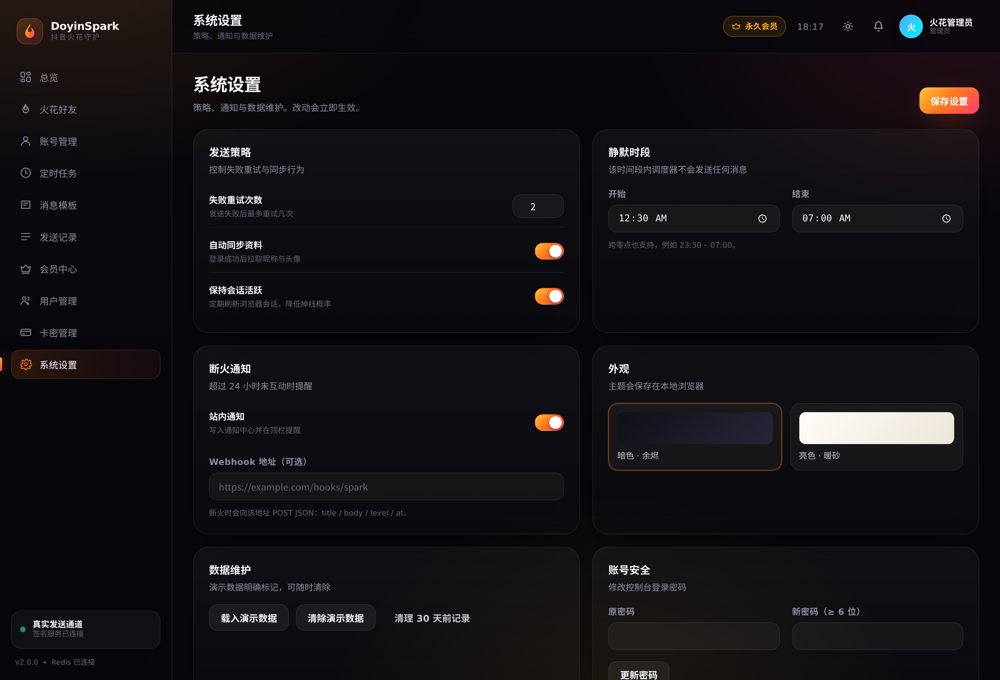 | 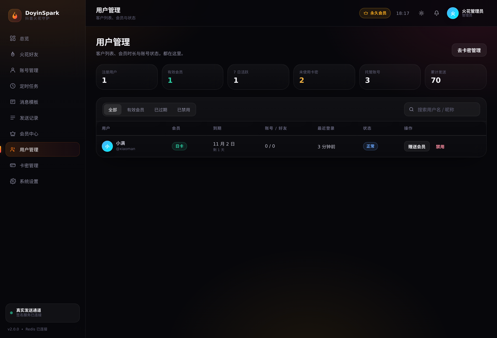 |

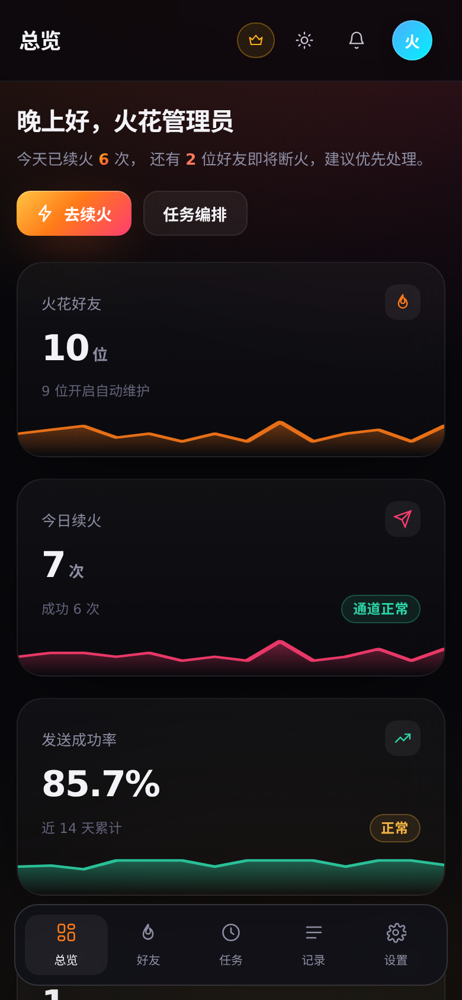

</details>

---

## 💎 会员与卡密（本次新增）

| 卡种 | 时长 | 参考价 | 说明 |
| --- | --- | --- | --- |
| 日卡 | 1 天 | ¥2 | 体验 |
| 周卡 | 7 天 | ¥9 | 短期托管 |
| 月卡 | 30 天 | ¥29 | 最常用 |
| 季卡 | 90 天 | ¥69 | 性价比 |
| 年卡 | 365 天 | ¥199 | 一次到位 |
| 永久卡 | 永久 | ¥399 | 长期可用 |

**规则**

- **注册必须带卡密**：没有未使用的卡密就无法创建账号，开通即生效
- **一卡一码**：卡密有独立有效期，兑换后立即标记 `used`，重复使用直接拒绝
- **天数叠加**：未过期时从原到期时间继续累加；已过期则从当下重新计算
- **到期拦截**：会员过期后登录只会拿到 2 小时的「待激活令牌」，只能调用兑换接口，业务接口一律 403；兑换成功后换发完整令牌
- **管理端**：批量生成（1–200 张/批，含卡密有效期与备注）、作废、导出 CSV、按状态/卡种/批次检索、直接给用户赠送会员

## 💼 SaaS 套餐配额（v3）

不同卡种对应不同的资源上限，**在创建和发送时由后端强制拦截**：

| 卡种 | 托管账号 | 火花好友 | 定时任务 | 每日发送 |
| --- | --- | --- | --- | --- |
| 日卡 | 1 | 3 | 1 | 10 |
| 周卡 | 2 | 10 | 2 | 50 |
| 月卡 | 3 | 30 | 5 | 200 |
| 季卡 | 5 | 100 | 10 | 500 |
| 年卡 | 10 | 300 | 30 | 2000 |
| 永久卡 | 不限 | 不限 | 不限 | 不限 |

- 创建账号/好友/任务时实时校验配额，超限返回 `403 + 可读原因`
- 每次发送前校验「今日发送」上限，防止刷量
- 会员中心显示用量进度条与剩余额度；超额时引导升级
- 管理端提供卡种分布、卡密营收、有效会员与活跃用户统计

## 🧑‍💼 多租户隔离

- 账号、好友、任务、模板、发送记录、设置、通知、审计全部按 `user_id` 隔离
- 每个接口都在 SQL 里带 `user_id` 条件，越权访问返回 404/403
- 管理员与客户共用一套表，用 `role` 区分；管理端路由额外校验 `role=admin`
- 新用户注册时自动从系统模板库复制一份模板并创建默认设置
- 旧版本单管理员数据会在启动时自动归属到管理员账号，不会丢

## ✨ 功能总览

| 模块 | 能力 |
| --- | --- |
| 登录 / 注册 | 卡密注册、登录、到期激活流程、修改密码、JWT + Redis 黑名单 |
| 会员中心 | 当前卡种/到期/剩余天数、卡种价格、兑换卡密、会员流水 |
| 卡密管理（管理员） | 批量生成、列表筛选、作废、复制、CSV 导出 |
| 用户管理（管理员） | 客户列表、会员与托管统计、赠送会员、禁用/恢复 |
| 总览看板 | KPI + 迷你趋势、14/30 天趋势、健康度环形图、7×24 热力图、火花榜、SSE 实时动态 |
| 火花好友 | 24h 倒计时环、四级状态、单发/批量续火、自动维护开关、筛选排序 |
| 账号管理 | 多账号托管、扫码登录、Cookie 导入校验、资料与会话同步、下线 |
| 定时任务 | 时间窗口可视化、间隔与单轮上限、启用/暂停、立即执行 |
| 消息模板 | 分类、占位符、启用开关、使用次数 |
| 发送记录 | 多维筛选、成功率、CSV 导出、旧记录清理 |
| 系统设置 | 重试、静默时段、断火通知 + Webhook、主题、演示数据、密码 |

## ⚠️ 抖音接口现状（2026-11 实测）

| 能力 | 状态 |
| --- | --- |
| 会话好友同步 | ✅ 从聊天页截获 `sec_user_ids` + `im/user/info` 批量换资料（实测 14 位） |
| 聊天框表情 | ✅ `emoji/list` 返回 371 个，已接入模板编辑器的表情选择器 |
| 扫码登录 / Cookie | ✅ 正常 |
| 发消息 | ✅ 页面自动化发送：真实键盘事件 + 回执确认（confirmed/uncertain/not_sent），不再走 protobuf |

实现细节见 [docs/DOUYIN-API.md](docs/DOUYIN-API.md)。发送回执为 confirmed 才计为成功；
回执不确定（uncertain）**不重试**，避免重复消息。

## 🧠 火花规则

- 24 小时窗口：双方需在 24 小时内互动一次，否则熄灭
- 同一天重复发送不加天数；≤ 24h 则 +1；超过 24h 从 1 重新开始
- 状态分级：安全（>8h）→ 预警（3–8h）→ 紧急（<3h）→ 已断火
- 调度器 20 秒心跳，Redis 分布式锁互斥，好友×日期幂等，静默时段跳过

## 🏗 架构

```
Vue 3 控制台 ──REST/SSE──► Go(Gin)
                            ├─ auth      注册/登录/激活令牌/会员兑换
                            ├─ service   火花状态机 · 调度器 · Sender · EventBus
                            ├─ cache     Redis（缓存/锁/幂等/限流/PubSub/JWT 黑名单）
                            ├─ model     GORM · MySQL 8
                            └─ signer    签名服务客户端
                                   │
                     MySQL 8.4 ────┴──── Redis 7
                                   │
                     sign-service（Node + Chromium + Xvfb）
                     每账号独立 profile · 扫码登录 · a_bogus 签名 · 站内 fetch
```

签名服务外置的原因：抖音 Web 接口需要 `a_bogus / X-Bogus`，签名由页面里的 `byted_acrawler`
生成，设备指纹（ttwid/fpk1/UIFID）绑定同一个浏览器实例；headless 会被跳到验证码页，
因此必须 headful + Xvfb，且每个账号一个独立 `user-data-dir`。

## 🔐 登录方式

两种模式，用 `AUTH_MODE` 切换：

| 模式 | 行为 |
| --- | --- |
| `simple`（默认，原逻辑） | 只有管理员账号 `admin / admin123`，没有注册页、卡密、会员与激活流程；不限制套餐配额 |
| `saas` | 客户自助注册（必须卡密）、会员到期拦截、套餐配额、卡密与运营后台 |

**抖音账号登录**始终在控制台内完成，不需要打开任何浏览器窗口：

- 「账号管理 → 扫码登录」：二维码直接显示在弹窗里，手机扫码确认
- 「账号管理 → 导入 Cookie」：粘贴完整 Cookie，导入后会调用资料接口做**真实校验**，无效直接拒绝

签名服务只在内网运行（不暴露 VNC / DevTools 端口），浏览器由系统托管，用户不需要看到它。

## 🚀 快速开始

```bash
docker compose up -d --build
# 控制台 → http://localhost:8790
# 管理员 admin / admin123（永久卡）
```

**开通一个客户账号（3 步）**

1. 管理员登录 → 侧边栏「卡密管理」→ 批量生成（选卡种、数量）→ 复制卡密
2. 打开 `/register`，填用户名/密码 + 卡密 → 注册即开通会员并直接进入控制台
3. 客户登录后在「会员中心」可继续兑换续期；管理员在「用户管理」可赠送或禁用

演示数据：控制台「系统设置 → 数据维护 → 载入演示数据」，仅写入当前登录用户名下，可一键清除。

## 🧪 自测与安全验证

仓库自带两个可复跑的脚本（需要服务已启动）：

```bash
python3 scripts/api-sweep.py      # 77 项接口冒烟：鉴权/会员/账号/好友/任务/模板/记录/设置/管理端/越权/SSE
python3 scripts/card-attack.py    # 卡密安全：随机爆破、错误文案一致性、限流、X-Forwarded-For 伪造
```

`api-sweep.py` 覆盖 77 个用例，包含越权（用户令牌访问管理端 → 403）、跨租户（改别人的账号 → 404）、
登出后令牌失效（Redis 黑名单）、限流（429）等负向路径；失败会打印期望/实际并以非零码退出，可直接接 CI。

**「同步会话」的正确姿势**：该按钮依赖真实登录态。
未添加账号时点击会提示并跳转「账号管理」；账号未扫码登录时接口返回 409
`账号「xxx」还未登录，请先扫码登录后再同步会话`，而不是静默失败。

## 🔐 卡密安全

| 维度 | 现状 |
| --- | --- |
| 长度与字符集 | `DYSP-XXXX-XXXX-XXXX`，32 符号（去掉 I/O/0/1）× 12 位 = **2^60 ≈ 1.15×10^18** 种 |
| 限流 | 兑换 8 次 / 5 分钟 / IP；注册 10 次 / 10 分钟 / IP |
| 一次性 | 兑换在事务内 `UPDATE ... WHERE status='unused'`，并发重复兑换只有一次成功 |
| 错误文案 | 不存在 / 已使用 / 已作废 / 已过期统一返回「卡密无效或已被使用」，不提供探测口 |
| 审计 | 每次失败写审计日志 + 服务端日志，卡密脱敏（`DYSP-XXXX****XXXX`） |
| 伪造 IP | `TRUSTED_PROXIES` 未配置时忽略 `X-Forwarded-For`，伪造头无法绕过限流 |

按 8 次/5 分钟计算，单 IP 一年只能尝试约 84 万次，穷举 2^60 需要 **1.37×10^12 年**。

**已知取舍**：卡密在库里是明文（管理端要导出、要可读），若数据库整体泄露，未使用的卡密会暴露。
高价值场景可以改成「只存 HMAC-SHA256(code) + 前后各 4 位明文展示」，兑换时哈希比对；
本项目保留明文是为了让管理员能随时导出交付，属于产品取舍，不是漏洞。

## ⚙️ 配置

| 环境变量 | 默认 | 说明 |
| --- | --- | --- |
| `PORT` | 8787 | 服务端口 |
| `DB_DSN` | — | MySQL DSN（utf8mb4） |
| `REDIS_ADDR` | 127.0.0.1:6379 | Redis |
| `JWT_SECRET` | — | 令牌密钥（≥16 字符） |
| `TOKEN_TTL_HOURS` | 72 | 完整令牌有效期（待激活令牌固定 2 小时） |
| `SIGN_SERVICE_URL` | — | 签名服务地址，留空则只读模式 |
| `TICK_SECONDS` | 20 | 调度心跳 |

## 🔌 API（新增部分）

```
POST /auth/register            卡密注册（卡密必填）
POST /auth/login               登录（过期返回 403 + 待激活令牌）
GET  /membership/plans         卡种与价格（公开）
GET  /membership               当前会员 + 流水（待激活令牌可访问）
POST /membership/redeem        兑换卡密（待激活令牌可访问，成功换发完整令牌）

GET  /admin/stats              运营概览
GET  /admin/users              用户列表
PATCH /admin/users/:id         改昵称/状态/角色
POST /admin/users/:id/grant    赠送会员
GET  /admin/cards              卡密列表
POST /admin/cards/generate     批量生成
POST /admin/cards/:id/void     作废
GET  /admin/cards/export       导出 CSV
```

## 🗂 目录

```
server/internal/
├── handler/   auth · membership · admin · dashboard · account · friend · task · template · record · setting · system · event
├── service/   spark(状态机) · sender(发送) · scheduler(调度) · membership(卡种/卡密) · events(总线)
├── model/     User · CardKey · MembershipLog · Account · Friend · Task · Template · Record · Setting · Notification · AuditLog
├── store/     迁移、管理员种子、模板库、旧数据认领
├── cache/     Redis 封装
└── signer/    签名服务客户端
web/src/views/ Login · Register · Membership · AdminUsers · AdminCards · Dashboard · Friends · Accounts · Tasks · Templates · Records · Settings
sign-service/  浏览器签名服务
```

## ⚠️ 免责声明

仅供学习研究与个人自用。卡密与会员体系只用于本项目自身的授权管理；请控制发送频率并遵守平台规则。
