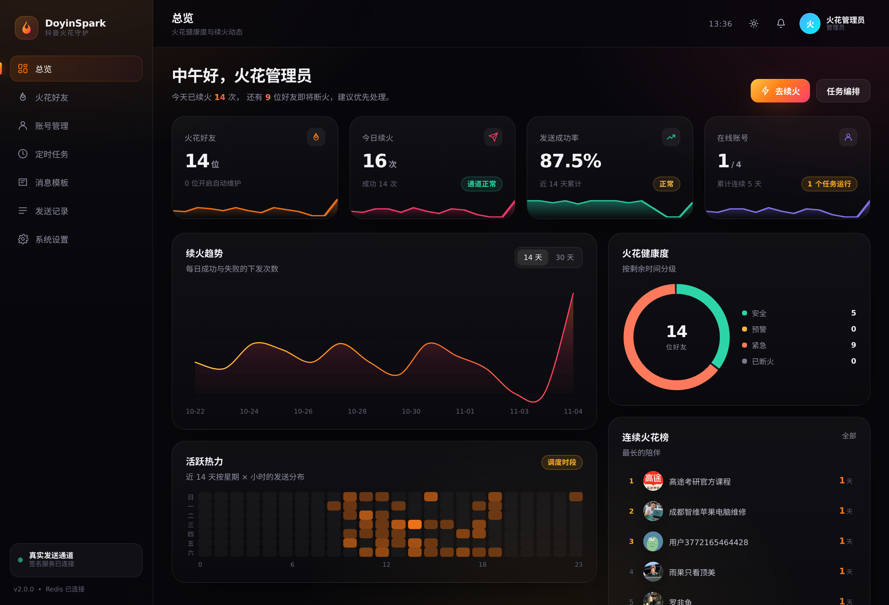
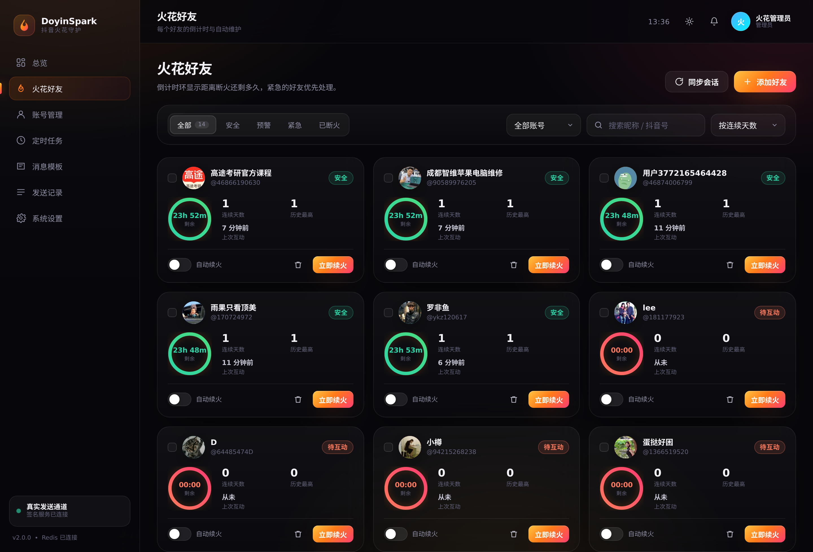

<div align="center">

# 🔥 DoyinSpark · 抖音火花守护

**多账号托管 · 定时自动续火 · 断火预警 · 真实浏览器发送**

Go + Gin + GORM + MySQL + Redis ｜ Vue 3 + TypeScript + Vite ｜ Chromium 签名服务

</div>

---

## 📸 界面





---

## ✨ 功能

| 模块 | 说明 |
| --- | --- |
| 总览看板 | 火花健康度、今日续火、成功率、近 14 天趋势、7×24 活跃热力图、连续天数榜、实时动态 |
| 火花好友 | 24 小时倒计时环、安全/预警/紧急/断火四级、单个或批量续火、**自动续火默认关闭**、按需开启 |
| 账号管理 | 多账号托管、控制台内扫码登录、Cookie 导入（真实校验）、资料与会话同步 |
| 定时任务 | 时间窗口 + 轮询间隔（±30% 随机抖动）、单轮上限、立即执行、下次执行推算 |
| 消息模板 | 分类管理、`{{name}} {{days}} {{date}} {{time}} {{weekday}}` 占位符、聊天框表情选择器 |
| 发送记录 | 状态/来源/账号/关键词筛选、成功率、CSV 导出 |
| 系统设置 | 重试、静默时段、断火通知 + Webhook、新号冷启动、主题切换、演示数据 |

## 🛡 防封设计

| 措施 | 做法 |
| --- | --- |
| 稳定设备指纹 | 每账号绑定 UA / 时区 / 语言 / 分辨率，落盘持久化，重启不变 |
| 独立 profile | 一账号一浏览器目录，登录态与指纹长期固定 |
| 先读后发 | 打开会话后随机停留、滚动看历史，再输入 |
| 节奏随机 | 任务间隔 ±30%、每条间随机停顿、逐字输入延迟抖动 |
| 内容去重 | 同账号同一天不重复使用同一模板 |
| 新号冷启动 | 注册后 3 天每天最多 5 条（可配置） |
| 风控熔断 | 命中「风控/频繁/验证码/403」等信号自动冷却至次日 06:00 并通知 |
| 回执三态 | `confirmed / uncertain / not_sent`，**不确定不重试**，避免重复消息 |
| 出口可配 | 账号支持独立代理，一号一出口 |

## 🧠 火花规则

- 24 小时窗口：双方需在 24 小时内互动一次，否则火花熄灭
- 同一天重复互动不增加天数；距上次 ≤ 24h 则 +1；超过 24h 从 1 重新开始
- 状态分级：安全（>8h）→ 预警（3–8h）→ 紧急（<3h）→ 已断火
- 调度器 20 秒心跳，Redis 分布式锁互斥，好友×日期幂等，静默时段跳过

## 🚀 快速开始

```bash
docker compose up -d --build
# 控制台 → http://localhost:8790   默认 admin / admin123（请立即修改）
```

四个容器：`app`（Go + 前端静态资源）、`mysql`、`redis`、`sign`（Chromium 会话与签名）。

**接入抖音账号**

1. 「账号管理」→ 添加账号
2. 扫码登录（二维码显示在控制台弹窗里，手机扫码确认）或粘贴完整 Cookie
3. 账号在线后，「火花好友」→ 同步会话，好友默认**不开启**自动续火
4. 需要自动续火的好友逐个打开开关（或勾选后批量开启）
5. 「定时任务」创建任务，调度器会在时间窗口内为已开启的好友补火

## 🏗 架构

```
Vue 3 控制台 ──REST/SSE──► Go(Gin)
                            ├─ handler   auth / account / friend / task / template / record / setting
                            ├─ service   火花状态机 · 调度器 · Sender · EventBus
                            ├─ cache     Redis（缓存 / 锁 / 幂等 / 限流 / PubSub / 模板去重）
                            └─ signer    签名服务客户端
                                   │
                     MySQL 8 ──────┴────── Redis 7
                                   │
                     sign-service（Node + Chromium）
                     每账号独立 profile · 扫码登录 · 页面内真实键盘输入发送
```

**为什么需要常驻浏览器**：抖音 Web 私信已迁到 `imapi.douyin.com` 的 protobuf 协议，且请求带设备级签名
（`bd-ticket-guard-client-data`），无法在浏览器外构造。因此发送改为"页面内真实键盘输入 + 回执确认"，
签名与风控全部交给浏览器自身完成。

## 📂 目录

```
server/        Go 后端（Gin + GORM + Redis）
web/           Vue 3 + TS 前端
sign-service/  Chromium 会话服务（登录 / 同步 / 发送）
docs/          架构说明、接口笔记、截图
scripts/       接口回归脚本、卡密安全测试
```

## ⚠️ 已知限制

- 发送依赖真实浏览器登录态，账号掉线会失败并记录原因，不会伪造成功
- 每人每天默认只发一条（幂等），续火效果取决于对方是否回应
- 需要本机能长期运行（容器 + 签名服务），关机会导致定时任务暂停

## ⚖️ 免责声明

本项目仅供个人学习与自用，用于维护自己账号的火花。请控制发送频率、遵守平台规则；
使用产生的账号风险由使用者自行承担。
